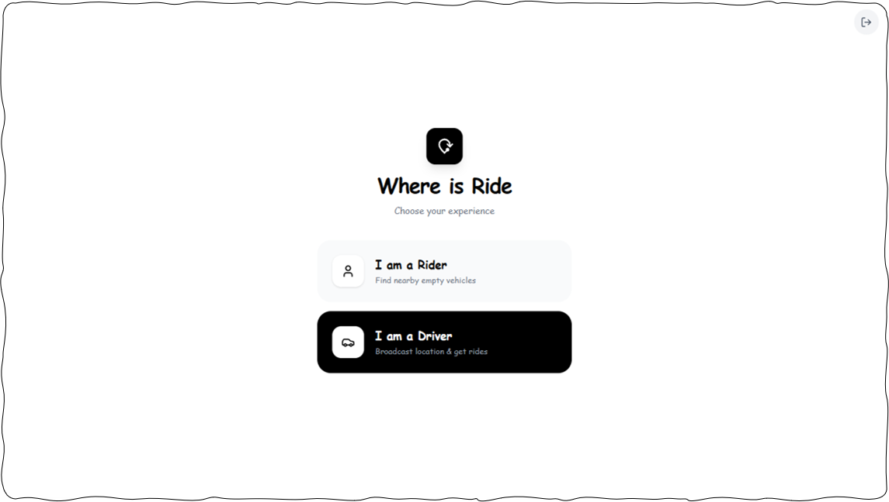

# Where is Ride
Know exactly where your ride is? A real-time vehicle tracking app for Android.

Stop guessing when your vehicle will arrive. Where is Ride gives you live location, real-time status, and instant alerts, all in one clean app.

[](https://heysanzu.github.io/WhereIsRide/)
[](https://github.com/heysanzu/WhereIsRide/releases/download/WhereIsRide_v1.0/WhereIsRide.apk)



---  

```bash
git clone https://github.com/heysanzu/WhereIsRide.git
cd WhereIsRide
```
<p align="left">
  
</p>

---

## Team (2025–26)

- **Leader:**  Shahnewaz [`@heysanzu`](https://github.com/heysanzu)
- **Co-Leader 1:**  Abhishek [`@Aprav-X`](https://github.com/Aprav-X)
- **Co-Leader 2:**  Kriti [`@itskriti-s`](https://github.com/itskriti-s)
- **Member 3:**  Akash [`@deepakashmandal`](https://github.com/deepakashmandal)
- **Member 4:**  Nisha [`@nishamahato114-svg`](https://github.com/nishamahato114-svg)
- **Member 5:**  Sandip [`@sandip-098`](https://github.com/sandip-098)

Maintained by [@heysanzu](https://github.com/heysanzu)
